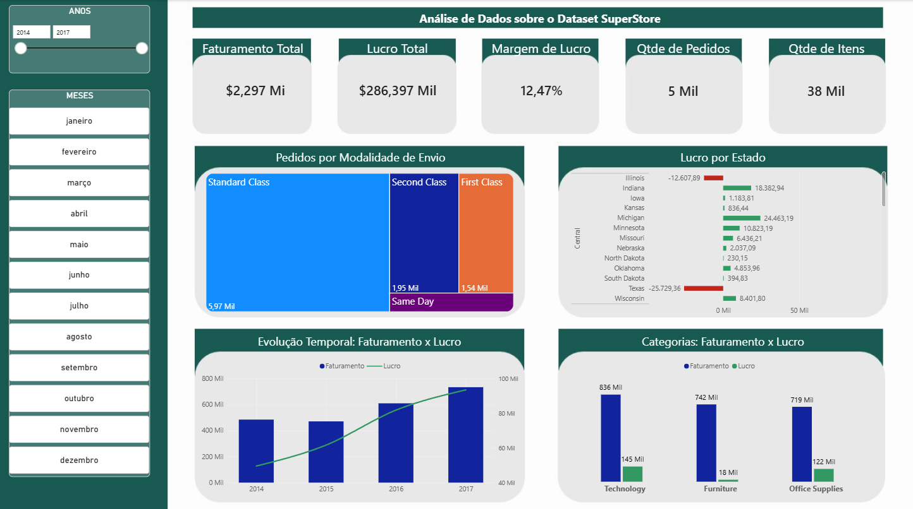
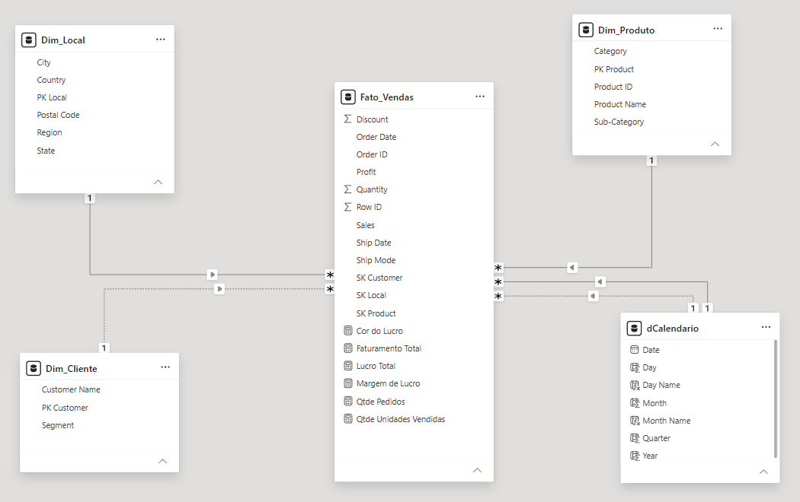

# Dashboard de Análise de Vendas - SuperStore

Este projeto consiste em um dashboard interativo desenvolvido no **Power BI** para análise do desempenho comercial e financeiro da base de dados fictícia **SuperStore** (Kaggle).

---

### Objetivo do Projeto

O objetivo principal deste relatório é fornecer visibilidade estratégica sobre o faturamento, lucratividade, comportamento de envios e categorias de produtos da empresa, auxiliando na tomada de decisão orientada a dados.

---

### Indicadores Chave (KPIs)

* **Faturamento Total:** $2,297 Mi
* **Lucro Total:** $286,397 Mil
* **Margem de Lucro:** 12,47%
* **Quantidade de Pedidos:** 5 Mil
* **Quantidade de Itens Vendidos:** 38 Mil

---

### Visões do Dashboard

O painel inclui as seguintes análises visuais:
* **Filtros Laterais:** Segmentação por Período (Anos e Meses).
* **Pedidos por Modalidade de Envio:** Distribuição dos pedidos por classe de envio (*Standard Class*, *Second Class*, *First Class* e *Same Day*).
* **Lucro por Estado:** Análise regional destacando estados lucrativos e com prejuízo (ex: Texas e Illinois).
* **Evolução Temporal (Faturamento x Lucro):** Acompanhamento do crescimento ano a ano (2014 a 2017).
* **Categorias (Faturamento x Lucro):** Comparativo de desempenho entre *Technology*, *Furniture* e *Office Supplies*.

---

### Modelagem de Dados (Star Schema)

A modelagem de dados foi estruturada no formato **Esquema em Estrela (Star Schema)**, garantindo otimização de performance e facilidade de leitura das métricas:

* **Tabela Fato:**
  * `Fato_Vendas`: Registro de transações, itens vendidos, faturamento, custos e medidas DAX personalizadas.
* **Tabelas Dimensão:**
  * `Dim_Cliente`: Informações do comprador e segmento.
  * `Dim_Local`: Dados geográficos (Cidade, Estado, Região, Código Postal).
  * `Dim_Produto`: Detalhes dos produtos, subcategorias e categorias.
  * `dCalendario`: Tabela temporal para inteligência de tempo (Data, Mês, Trimestre, Ano).

---

### Tecnologias e Ferramentas Utilizadas

* **Power BI Desktop:** Construção do relatório, gráficos e medidas DAX.
* **Power Query:** Tratamento e limpeza dos dados.
* **Kaggle:** Fonte do conjunto de dados [SuperStore Dataset](https://www.kaggle.com/datasets/vivek468/superstore-dataset-final).

---

### Autor

Desenvolvido por **Daniel Alves**  
* [LinkedIn](https://www.linkedin.com/in/daniel-a-s-ferreira/)
* [GitHub](https://github.com/daniel1773)
